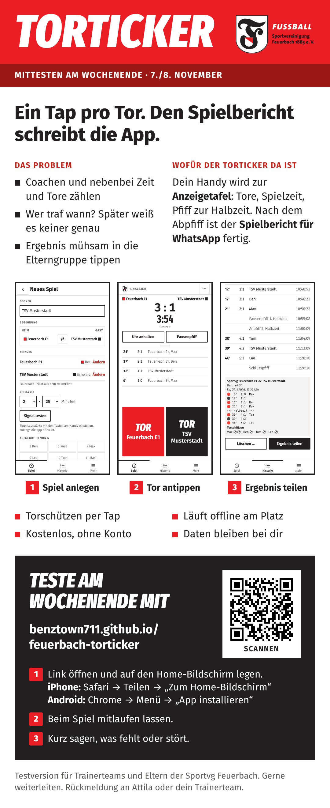

# Flyer für Testerinnen und Tester



Ein Bild im Handyformat (1080 px breit) für die Trainergruppe in WhatsApp, zum Weiterleiten an interessierte Eltern. Inhalt: Problem, Zweck, drei echte Bildschirme der App (fiktive Namen), Aufruf zum Mittesten mit Link und QR-Code.

## WhatsApp-Text zum Bild

```text
Hallo zusammen,
für den Spielfeldrand gibt es jetzt den *Torticker*: ein Tap pro Tor, die Uhr läuft mit und pfeift zur Halbzeit. Nach dem Abpfiff ist der Spielbericht für die Elterngruppe fertig.

Wer Lust hat, testet am Wochenende (7./8.11.) beim Spiel mit:
https://benztown711.github.io/feuerbach-torticker/

iPhone: Link in Safari öffnen → Teilen → „Zum Home-Bildschirm“
Android: Link in Chrome öffnen → Menü → „App installieren“
Tipp: App während des Spiels offen lassen, dann kommt der Pfiff.

Kostenlos, ohne Anmeldung, ohne Werbung. Alle Daten bleiben auf eurem Handy.
Gerne an interessierte Eltern weiterleiten. Rückmeldung an mich: Was hat gefehlt, was hat gestört?
```

Bild in WhatsApp mit "HD" senden, sonst wird die Schrift unscharf.

## Neu erzeugen

Nach Änderungen an der App oder am Text (`flyer.html`):

```bash
npm run build && npm run flyer
```

Das Skript `scripts/flyer.ts` startet die gebaute App, spielt ein Beispielspiel mit fiktiven Namen durch, speichert die Bildschirme nach `screens/` und rendert `flyer.html` als `flyer.png`. Mit `--nur-flyer` wird nur das Bild neu gerendert. Im Cloud-Container vorher `PW_CHROMIUM_PATH=/opt/pw-browsers/chromium` setzen.

Farben, Schriften und Logos kommen aus `design/` (über `src/styles/tokens.css`). `qr.svg` enthält den Link zur App.
